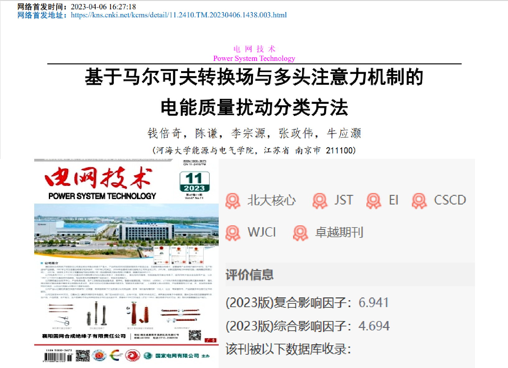
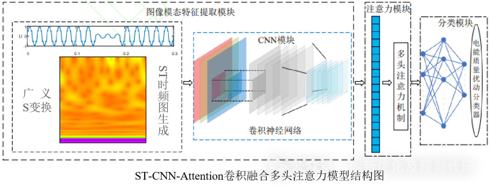
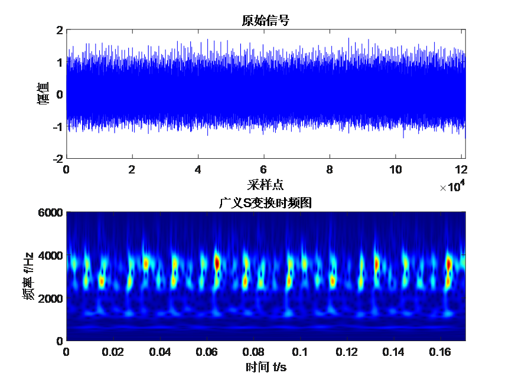
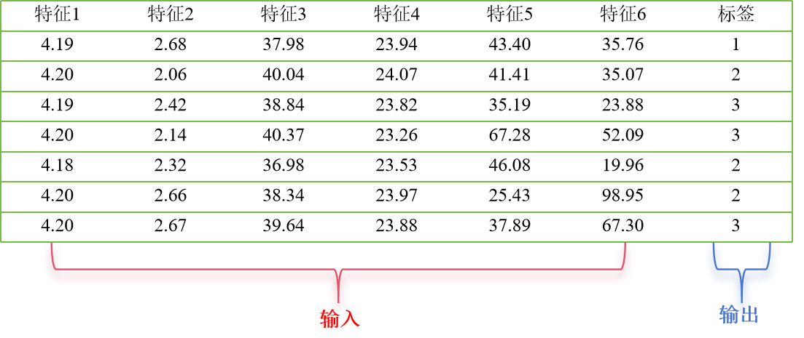
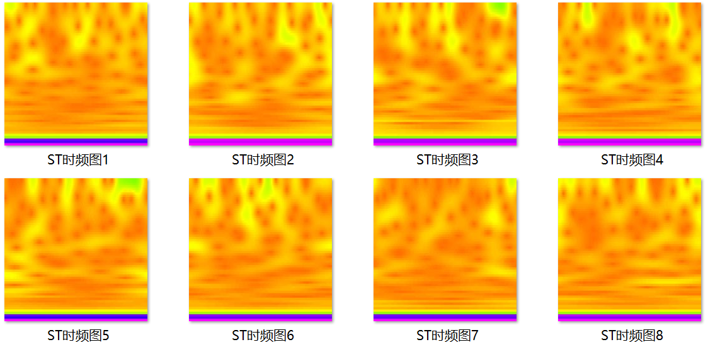
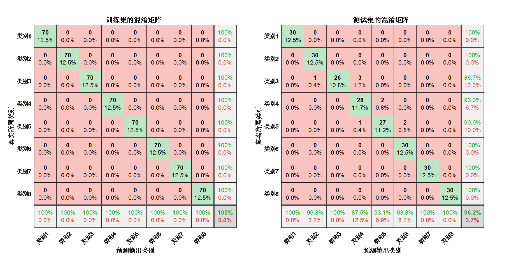
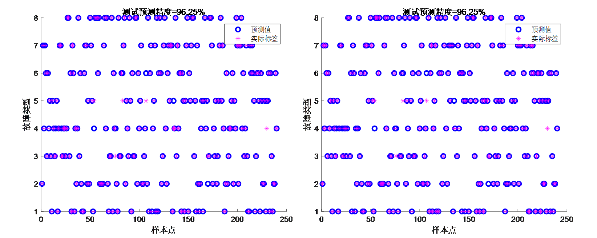
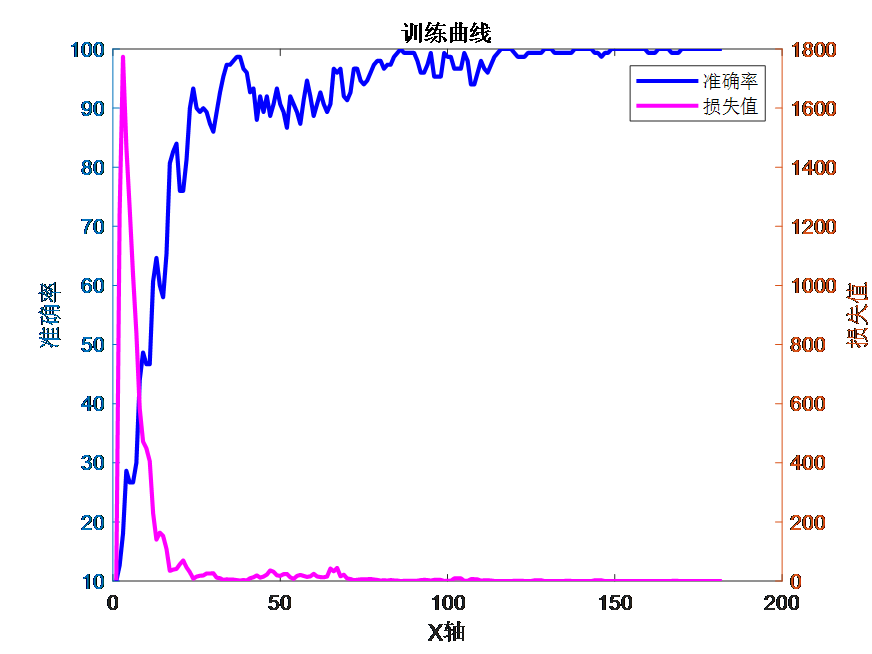

# 2024 First Release! ST-CNN-MSA Fault Identification Program Based on S-Transform Time-Frequency Graphs and Convolutional Neural Networks (CNN) with a Multi-Head Self-Attention Mechanism

Applicable Platform: Matlab 2023 version and above
Principle: The generalized S-transform is a time-frequency analysis method aimed at solving the limitations of traditional Fourier transforms and short-time Fourier transforms for analyzing non-stationary signals. It can capture the local instantaneous frequency at different points in time, effectively capturing the instantaneous characteristics of signals, providing more detailed time-frequency analysis results. Therefore, using ST-time-frequency plots to mine the hidden features of fault waveforms and perform two-dimensional visualization.
ST-CNN-Attention methods for fault identification have several innovative aspects:
Data Representation Innovation: Typically, one-dimensional sequences (such as time series data) are directly used for modeling and analysis. Transforming these sequences into generalized S-transform time-frequency images is a new method of data representation. This transformation may reveal new patterns and structural features in the sequence data that may not be as obvious or difficult to detect in the original one-dimensional form. It is more effective than traditional time-series analysis methods in capturing complex patterns and instantaneous features.
Image Processing Technology: By converting the sequence data into images, mature image processing techniques and image recognition algorithms can be utilized for data analysis. This includes using various image recognition methods such as convolutional neural networks (CNN), which have proven highly effective in image analysis but are not commonly used in traditional sequence data analysis.
Capturing Time Dependentness: The generalized S-transform time-frequency plot is a mathematical model used to represent the dependence between random variables. It reveals the chaos, stationarity, and inherent similarity of time series, mining the hidden features of fault waveforms, and enhancing fault characteristics. When converting the sequence data into ST-time-frequency plots, it achieves high-resolution time-frequency analysis of fault waveforms. This means it can more accurately capture subtle changes and frequency components in the waveform, thereby better identifying and analyzing fault characteristics.
Multi-head Self Attention: This mechanism effectively captures the contribution of features, focusing on key points to enhance fault identification accuracy.
Program application: The Generalized S-Transform (ST) generates two-dimensional images from one-dimensional time series. Then, a CNN is used to extract high-dimensional features. With Multi-head Self Attention (MSA), these features are further emphasized, improving fault identification accuracy.
Input data format: Each row represents an individual sample, with the last column indicating the category label for the fault.
ST time-frequency graph generation:
Fault identification results: Confusion matrix for both training and testing sets
Training set and testing set scatter plots
Training curve: Accuracy and loss changes

## Images

<!-- PAYMENT_BLOCK -->

## Get this dataset

- Payment link (Stripe): [Buy now](https://buy.stripe.com/3cs8yP7sY87d0vu9AB)
- Payment QR code: 

<!-- /PAYMENT_BLOCK -->
